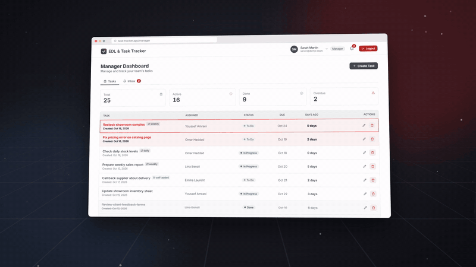

<div align="center">


# EDL & Task Tracker

**Real-time task management for teams, built with Next.js and Supabase.**

[](https://alae-eddinee.github.io/edl-task-tracker/)

▶ **[Watch the full demo with sound (56 s)](https://alae-eddinee.github.io/edl-task-tracker/)**

<sub>The demo uses made-up people and tasks.</sub>

</div>

---

## Features

**Role-based dashboards**
- **Admin**: create and edit users, assign roles, reset passwords (which also signs the user out everywhere), and see who is online.
- **Manager**: create, edit and delete tasks, assign them to employees, and follow every employee's workload in the *Employee tracking* view.
- **Employee**: see assigned tasks, change their status, comment, and add tasks for themselves. They can fix their own tasks later: every edit is marked as *edited* and the managers are told exactly what changed.

**Tasks**
- Status: To Do / In Progress / Done, changed from a Notion-style pill menu.
- 🚨 **BOMBE** priority: urgent tasks are highlighted and always sorted to the top.
- **Recurring tasks** (daily, weekly on a chosen day, or monthly) that roll over automatically, with their own *Recurring* tab that you can filter by frequency.
- **Checklists inside tasks**: add small sub-steps, tick them off, and follow the progress (e.g. 2/5) right from the task list.
- Due dates, overdue tracking, "days ago" counters, and a *self-added* tag on tasks employees create for themselves.

**Real-time collaboration**
- Supabase Realtime keeps every open dashboard in sync, with no refresh needed.
- Toast notifications with sound, plus a notification inbox with read/unread state.
- Comments on every task, updated live.
- Optimistic updates that roll back if the server rejects the change.

**Security**
- Row Level Security on every table, plus role-based routing in the middleware.
- Admin actions run server-side using the service-role key.
- Sign in with an email address or just a name.

## Tech stack

| | |
|---|---|
| Framework | Next.js 16 (App Router), React 19 |
| Backend | Supabase (PostgreSQL, Auth, Realtime) |
| Styling | Tailwind CSS 4 |
| Language | TypeScript |
| Icons / dates | Lucide, date-fns |

## Quick start

```bash
git clone https://github.com/alae-eddinee/edl-task-tracker.git
cd edl-task-tracker
npm install
```

1. Create a project at [supabase.com](https://supabase.com).
2. In the SQL editor, run `supabase-schema.sql`, then the files in `supabase/migrations/` in order.
3. Create `.env.local`:

   ```env
   NEXT_PUBLIC_SUPABASE_URL=your-project-url
   NEXT_PUBLIC_SUPABASE_ANON_KEY=your-anon-key
   SUPABASE_SERVICE_ROLE_KEY=your-service-role-key
   ```

4. Run `npm run dev` and open http://localhost:3000.
5. Sign up, then set your user's `role` to `admin` in the `profiles` table and sign in again.

See [SETUP.md](SETUP.md) for the detailed walkthrough.

## Project structure

```
src/
├── app/
│   ├── admin/        # Admin dashboard
│   ├── manager/      # Manager dashboard
│   ├── employee/     # Employee dashboard
│   ├── login/
│   └── api/          # Server routes for admin actions and login
├── components/
│   ├── layout/       # Header, StatsCard, NotificationInbox, OnlineUsers
│   └── ui/           # Buttons, modals, StatusSelect, toasts...
├── hooks/            # useAuth, useNotifications
├── lib/              # Supabase clients, recurring-task logic, time helpers
└── middleware.ts     # Auth + role-based routing
docs/demo/            # The demo video and the code that renders it
```

## About the demo video

The video is generated from code, not screen-recorded. [`docs/demo/demo.html`](docs/demo/demo.html) is a scripted 3D animation of the app's UI, [`gen_audio.py`](docs/demo/gen_audio.py) synthesizes the music and sound effects, and [`render.mjs`](docs/demo/render.mjs) renders it frame by frame with Playwright and ffmpeg:

```bash
python docs/demo/gen_audio.py     # needs numpy + scipy
node docs/demo/render.mjs         # needs playwright + ffmpeg
```

## License

MIT
